# REPORT JOBSHEET 9: ARRAY 1

Name: Davina Tegar Putri Ervia
NIM: 264107020083
GitHub: https://github.com/davinategar

# 1. Objective

* Students are able to understand the concept of one-dimensional arrays and how to declare, initialize,and access their elements in the Java programming language.
* Students are able to write programs that use one-dimensional arrays to store and process data,including the use of for and foreach loops.
* Students are able to apply arithmetic operations to array elements, such as calculating the total,average, highest value, and lowest value.
* Students are able to apply simple searching and sorting algorithms to one-dimensional arrays.
* Students are able to apply one-dimensional arrays to solve case studies that are relevant to campuslife and everyday situations.

# 2. Lab Exercises

## 2.1 Experiment 1: Declaring, Initializing, Filling, and Displaying Array Elements

**The code:**

```
import java.util.Arrays;

public class NumberArray07 {
    public static void main(String[] args) {
        int[] numbers = new int[4];

        numbers[0] = 5;
        numbers[1] = 13;
        numbers[2] = -7;
        numbers[3] = 17;

        for (int i = 0; i < numbers.length; i++) {
            System.out.println("numbers[" + i + "] = " + numbers[i]);
        }

        for (int number : numbers) {
            System.out.println(number);
        }

        System.out.println(Arrays.toString(numbers));
    }
}
```

**Result:**

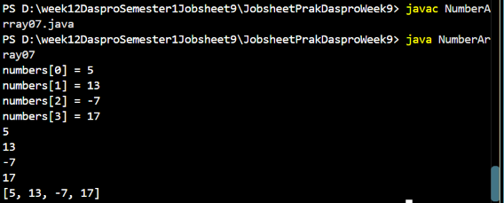

**Questions:**

1. If the elements of the numbers array are changed to ```5.0, 12867, 7.5, 2000000```, what happens? Why does this happen?

    Answer: when i want to run the program it will be error, because in my code i input it ```int``` so when i writhe those numbers it will causes error. If we want to get output those numbers, we have to use ```double```.

2. Modify the program above by initializing the array elements at the same time the array is declared (without new ```int[4]``` and without filling the elements one by one)

   Code:

   ```
   import java.util.Arrays;

    public class NumberArray07 {
        public static void main(String[] args) {
            int[] numbers = {5, 13, -7, 17};

        for (int i = 0; i < numbers.length; i++) {
            System.out.println("numbers[" + i + "] = " + numbers[i]);
        }

        for (int number : numbers) {
            System.out.println(number);
        }

        System.out.println(Arrays.toString(numbers));
      }
   }
   ```

   Result:

   

   _note: still same like the previous code_

3. Change the display statement in step 4 to the following: ```System.out.println("numbers[" + i + "] = " +numbers[i] + ", doubled = " + (numbers[i] * 2));``` What is the output of the program? Explain themeaning of the statement.

   Answer: This line is used to display each array element along with the result            of multiplying it by 2.

   Result:
   
    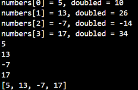

4. If the condition in the for loop above is changed to ```i <= 4```, what is the output of the program? Why?

   Answer: The program will produce an ArrayIndexOutOfBoundsException because                the array has only 4 elements, with indexes from 0 to 3. When i                  becomes 4, the program tries to access ```numbers[4]```, which does              not exist. Therefore, the program stops before executing the next                loops.

5. What is the difference between displaying an array using a for loop, a foreach loop, andArrays.toString() in step 5? When should each one be used?

   Answer: The for loop uses an index to access array elements, while the                   foreach loop accesses each element directly without using an index.              Arrays.toString() displays all array elements in one line. A for loop            is useful when we need the index, a foreach loop is useful when we               only need to read the elements, and Arrays.toString() is useful for d            isplaying the entire array quickly.

# 3. Lab Exercises

## 3.1 Experiment 2: SIAKAD Case Study — Entering Student Scores and Pass/Fail Status  

**The code:**

```
import java.util.Arrays;
import java.util.Scanner;

public class ScoreArrayp07 {
    public static void main(String[] args) {
        int[] finalScores = new int[10];
        Scanner input = new Scanner(System.in);
        
        for (int i = 0; i < finalScores.length; i++) {
            System.out.print("Enter score for student #" + (i + 1) + ": ");
            finalScores[i] = input.nextInt();
        }

        for (int i = 0; i < finalScores.length; i++){
            String status = (finalScores[i] > 70) ? "PASS" : "FAIL";
            System.out.println("Student #" + (i + 1) + " score: " + finalScores[i] + " - " + status);
        }
    }
}
```

**The Result:** 

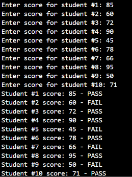

**Questions**

1. What does the condition ```i < finalScores.length``` in the loop above mean?

   Answer: The condition ```i < finalScores.length``` means that the loop will continue as long as the value of ```i``` is              smaller than the length of the array. The array finalScores contains 10 elements, so finalScores.length is 10.               The loop starts from ```i = 0``` and stops when i = 10.

2. Modify the program so that it displays only the scores of students who passed (score > 70), without displaying those who failed. Explain the flow of the program!

   Answer: The Code

   ```
   import java.util.Arrays;
   import java.util.Scanner;

    public class Exper {
    public static void main(String[] args) {
        int[] finalScores = new int[10];
        Scanner input = new Scanner(System.in);

        for (int i = 0; i < finalScores.length; i++) {
            System.out.print("Enter score for student #" + (i + 1) + ": ");
            finalScores[i] = input.nextInt();
        }

        for (int i = 0; i < finalScores.length; i++) {
            if (finalScores[i] > 70) {
                System.out.println("Student #" + (i + 1)
                        + " score: " + finalScores[i] + " - PASS");
            }
        }
    }
    }
   ```

   Result:

   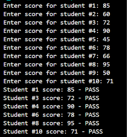

   Explanation:

   * First, the program creates an array to store 10 student scores.
   * The first for loop asks the user to enter scores for all 10 students.
   * The second for loop checks each student's score.
   * The if condition checks whether the score is greater than 70.
   * If the condition is true, the program displays the student's score and PASS status.
   * If the condition is false, the program skips that student and continues to the next one.

3. Change the loops in steps 4 and 5 from for loops to foreach loops. Can all parts of the program be converted to foreach? Explain which parts can and cannot be converted, along with the reasons.

   Answer: The Code:
   
   ```
   import java.util.Arrays;
   import java.util.Scanner;

    public class Experiment2Question4 {
    public static void main(String[] args) {
        int[] finalScores = new int[10];
        Scanner input = new Scanner(System.in);

        for (int i = 0; i < finalScores.length; i++) {
            System.out.print("Enter score for student #" + (i + 1) + ": ");
            finalScores[i] = input.nextInt();
        }

        int studentNumber = 1;

        for (int score : finalScores) {
            String status = (score > 70) ? "PASS" : "FAIL";

            System.out.println("Student #" + studentNumber
                    + " score: " + score + " - " + status);

            studentNumber++;
        }
    }
    }
   ```

   Result:
   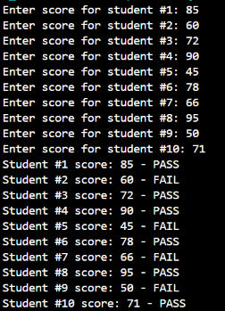

   Explanation:

   No, not all parts of the program can be converted to foreach loops.

   * The first loop cannot be directly converted into foreach because it is used to store input values into specific array        positions. A foreach loop does not provide direct access to array indexes for assigning values.
   * The second loop can be converted into foreach because it only reads and displays the scores stored in the array. It          does not need to change the array values.

   The variable studentNumber is used to display the student number because foreach does not automatically provide the array    index.

4. Modify the program so that it also calculates and displays the number of students who passed and the number of students who failed at the end of the program.

   Answer: The Code:

   ```   
    import java.util.Scanner;

    public class Experiment2Question4 {
    public static void main(String[] args) {
        int[] finalScores = new int[10];
        Scanner input = new Scanner(System.in);

        int passCount = 0;
        int failCount = 0;

        for (int i = 0; i < finalScores.length; i++) {
            System.out.print("Enter score for student #" + (i + 1) + ": ");
            finalScores[i] = input.nextInt();
        }

        for (int i = 0; i < finalScores.length; i++) {
            if (finalScores[i] > 70) {
                System.out.println("Student #" + (i + 1)
                        + " score: " + finalScores[i] + " - PASS");
                passCount++;
            } else {
                System.out.println("Student #" + (i + 1)
                        + " score: " + finalScores[i] + " - FAIL");
                failCount++;
            }
        }

        System.out.println("\nTotal students passed: " + passCount);
        System.out.println("Total students failed: " + failCount);
    }
    }
   ```

   Result:

   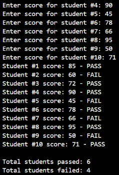

# 4. Lab Exercises

## 4.1. Experiment 3: Arithmetic Operations on Arrays — Total, Average, Highest and LowestScores

**The code:**

```
import java.util.Scanner;

public class AverageScoreArray07 {
    public static void main(String[] args) {

        Scanner input = new Scanner(System.in);

        int[] studentScores = new int[10];
        int total = 0;
        double average;

        for (int i = 0; i < studentScores.length; i++) {
            System.out.print("Enter the score for student #" + (i + 1) + ": ");
            studentScores[i] = input.nextInt();
            total += studentScores[i];
        }

        average = (double) total / studentScores.length;

        System.out.println("Total Score: " + total);
        System.out.println("Average: " + average);

        int highest = studentScores[0];
        int lowest = studentScores[0];

        for (int i = 1; i < studentScores.length; i++) {
            if (studentScores[i] > highest) highest = studentScores[i];
            if (studentScores[i] < lowest) lowest = studentScores[i];
        }

        System.out.println("Highest Score: " + highest);
        System.out.println("Lowest Score: " + lowest);

        String category;

        if (average >= 85) {
            category = "EXCELLENT";
        } else if (average >= 70) {
            category = "GOOD";
        } else {
            category = "NEEDS IMPROVEMENT";
        }

        System.out.println("Class Grade Category: " + category);

        input.close();
    }
}
```

**Result:**

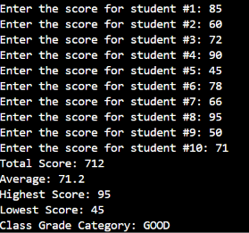

**Questions**

1. Modify the code above so that it displays the number of students who passed, that is, students whosescore is greater than 70 (> 70).

   Answer: Code:

   ```
    import java.util.Scanner;

    public class AverageScoreArray07 {
    public static void main(String[] args) {

        Scanner input = new Scanner(System.in);

        int[] studentScores = new int[10];
        int total = 0;
        int passed = 0;
        double average;

        for (int i = 0; i < studentScores.length; i++) {
            System.out.print("Enter the score for student #" + (i + 1) + ": ");
            studentScores[i] = input.nextInt();

            total += studentScores[i];

            if (studentScores[i] > 70) {
                passed++;
            }
        }

        average = (double) total / studentScores.length;

        int highest = studentScores[0];
        int lowest = studentScores[0];

        for (int i = 1; i < studentScores.length; i++) {
            if (studentScores[i] > highest) {
                highest = studentScores[i];
            }

            if (studentScores[i] < lowest) {
                lowest = studentScores[i];
            }
        }

        String category;

        if (average >= 85) {
            category = "EXCELLENT";
        } else if (average >= 70) {
            category = "GOOD";
        } else {
            category = "NEEDS IMPROVEMENT";
        }

        System.out.println("Total Score: " + total);
        System.out.println("Average: " + average);
        System.out.println("Highest Score: " + highest);
        System.out.println("Lowest Score: " + lowest);
        System.out.println("Students Passed: " + passed);
        System.out.println("Class Grade Category: " + category);

        input.close();
    }
    }
    ```

   Result:

   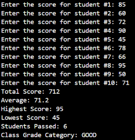

2. Modify the program above so that it accepts the number of array elements from user input (notalways 10), while still calculating the total, average, highest value, and lowest value correctly.

   Answer: code:

   ```   
    import java.util.Scanner;

    public class AverageScoreArray07 {
    public static void main(String[] args) {

        Scanner input = new Scanner(System.in);

        System.out.print("Enter the number of students: ");
        int n = input.nextInt();

        int[] studentScores = new int[n];
        int total = 0;
        int passed = 0;
        double average;

        for (int i = 0; i < studentScores.length; i++) {
            System.out.print("Enter the score for student #" + (i + 1) + ": ");
            studentScores[i] = input.nextInt();

            total += studentScores[i];

            if (studentScores[i] > 70) {
                passed++;
            }
        }

        average = (double) total / studentScores.length;

        int highest = studentScores[0];
        int lowest = studentScores[0];

        for (int i = 1; i < studentScores.length; i++) {
            if (studentScores[i] > highest) {
                highest = studentScores[i];
            }

            if (studentScores[i] < lowest) {
                lowest = studentScores[i];
            }
        }

        String category;

        if (average >= 85) {
            category = "EXCELLENT";
        } else if (average >= 70) {
            category = "GOOD";
        } else {
            category = "NEEDS IMPROVEMENT";
        }

        System.out.println("\nTotal Score: " + total);
        System.out.println("Average: " + average);
        System.out.println("Highest Score: " + highest);
        System.out.println("Lowest Score: " + lowest);
        System.out.println("Students Passed: " + passed);
        System.out.println("Class Grade Category: " + category);

        input.close();
    }
    }
   ```
   Result:

   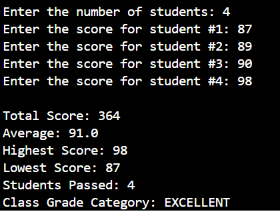

3. Why is (double) total / studentScores.length used in the average calculation instead of simply total /studentScores.length? Explain!

   Answer: Because Java performs integer division when both numbers are integers.

# 5. Lab Exercises

## 5.1. Experiment 4:  Simple Searching and Sorting

**The code:**

```

// Part A: Linear Search

public class ScoreSearch07 {
    public static void main(String[] args) {

        int[] scores = {78, 65, 90, 55, 88, 72};
        int key = 90;
        boolean found = false;

        for (int i = 0; i < scores.length; i++) {
            if (scores[i] == key) {
                System.out.println("Score " + key + " was found at index " + i);
                found = true;
                break;
            }
        }

        if (!found) {
            System.out.println("Score " + key + " was not found.");
        }
    }
}

```

**Result:**

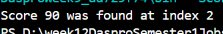

**The code:**

```
import java.util.Arrays;;

public class ScoreSearch07PartB {
    public static void main(String[] args) {
        
        int[] scores = {78, 65, 90, 55, 88, 72};
        for (int i = 0; i < scores.length - 1; i++) {
            for (int j = 0; j < scores.length - 1 - i; j++) {
                if (scores[j] > scores[j + 1]) {
                    int temp = scores[j];
                    scores[j] = scores[j + 1];
                    scores[j + 1] = temp;
                }
            }
        }

        System.out.println(Arrays.toString(scores));
    }
}
```

**Result**

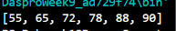

**Questions:**

1. Explain the meaning of the break; statement in the Part A code.

   Answer: The break; statement is used to stop the loop immediately when the searched value (key) is found. In this program, when scores[i] == key is true, the program                displays the index position, sets found = true, and then executes break; to stop searching. Without break;, the loop would continue checking the remaining                   elements even though the value has already been found.

2. Modify the Part A code so that the program accepts, as user input, the number of elements in thescores array, the array contents, and a value (key) to search for, and then prints the index position ofthat value (key) in the array.

   Answer: code:

   ```
    import java.util.Scanner;
    
        public class ScoreSearch07PartA {
        public static void main(String[] args) {

        Scanner input = new Scanner(System.in);

        System.out.print("Enter the number of scores: ");
        int n = input.nextInt();

        int[] scores = new int[n];

        for (int i = 0; i < scores.length; i++) {
            System.out.print("Enter score #" + (i + 1) + ": ");
            scores[i] = input.nextInt();
        }

        System.out.print("Enter the score to search for: ");
        int key = input.nextInt();

        boolean found = false;

        for (int i = 0; i < scores.length; i++) {
            if (scores[i] == key) {
                System.out.println("Score " + key + " was found at index " + i);
                found = true;
                break;
            }
        }

        if (!found) {
            System.out.println("Score " + key + " was not found.");
        }

        input.close();
    }
   }
   ```

   Output:

   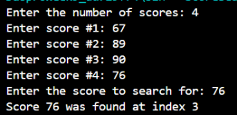
   
3. Modify the Part A program so that it displays the message "The value you are looking for was notfound" in a more informative format when the value being searched for (key) does not exist in thearray.

   Answer: code:

    ```
    import java.util.Scanner;

    public class ScoreSearch07PartA {
    public static void main(String[] args) {

        Scanner input = new Scanner(System.in);

        System.out.print("Enter the number of scores: ");
        int n = input.nextInt();

        int[] scores = new int[n];

        for (int i = 0; i < scores.length; i++) {
            System.out.print("Enter score #" + (i + 1) + ": ");
            scores[i] = input.nextInt();
        }

        System.out.print("Enter the score to search for: ");
        int key = input.nextInt();

        boolean found = false;

        for (int i = 0; i < scores.length; i++) {
            if (scores[i] == key) {
                System.out.println("Score " + key +
                    " was found at index " + i);
                found = true;
                break;
            }
        }

        if (!found) {
            System.out.println("The value " + key +
                " was not found in the scores array.");
        }

        input.close();
    }
    }

    ```

Output:

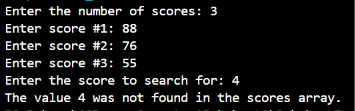

4. Explain step by step how the bubble sort algorithm in Part B works, using the test data provided!

   Answer: Bubble Sort is a sorting algorithm that compares two neighboring elements and swaps them if they are in the wrong order. In this program, the array is sorted                from the smallest to the largest value (ascending order).

   The sorting process:

   * Pass 1:
    - Compare 78 and 65 → Swap.
    - Compare 78 and 90 → No swap.
    - Compare 90 and 55 → Swap.
    - Compare 90 and 88 → Swap.
    - Compare 90 and 72 → Swap.

  * Pass 2
    - Compare 65 and 78 → No swap.
    - Compare 78 and 55 → Swap.
    - ompare 78 and 88 → No swap.
    - Compare 88 and 72 → Swap. 

  * Pass 3
    - Compare 65 and 55 → Swap.
    - Compare 65 and 78 → No swap.
    - Compare 78 and 72 → Swap.

  * Pass 4 and 5 : The program continues comparing neighboring elements. No more swaps are needed because the array is already sorted.

5. Modify the Part B program so that it sorts the array from the largest to the smallest value(descending), instead of from the smallest to the largest.

   Answer: To change the sorting order from ascending to descending, we only need to change the comparison condition:

   the code:

   ```
    import java.util.Arrays;

    public class ScoreSearch07PartB {
    public static void main(String[] args) {

        int[] scores = {78, 65, 90, 55, 88, 72};

        for (int i = 0; i < scores.length - 1; i++) {
            for (int j = 0; j < scores.length - 1 - i; j++) {

                if (scores[j] < scores[j + 1]) {
                    int temp = scores[j];
                    scores[j] = scores[j + 1];
                    scores[j + 1] = temp;
                }
            }
        }

        System.out.println(Arrays.toString(scores));
    }
    }
   ```

    Result:

   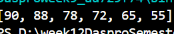

# 6. Assignments

## 6.1 Assignment 1 — Managing Student Scores

**Question:**

Write a program that can store and manage student scores (integers). The program must provide featuresto:

- Enter the number of student scores to be input.• Enter each student score one by one.
- Calculate the average of all of the scores entered.
- Display the highest and lowest scores.• Display all of the scores entered, along with their pass/fail status (PASS / FAIL).

**The code result:**

```
import java.util.Scanner;

public class Assignment1 {
    public static void main(String[] args) {
        Scanner sc = new Scanner(System.in);

        System.out.print("Input number of students: ");
        int n = sc.nextInt();

        int[] scores = new int[n];

        for (int i = 0; i < n; i++) {
            System.out.print("input the score to-" + (i + 1) + ": ");
            scores[i] = sc.nextInt();
        }

        int total = 0;
        int highest = scores[0];
        int lowest = scores[0];

        for (int i = 0; i < n; i++) {
            total += scores[i];
            if (scores[i] > highest) highest = scores[i];
            if (scores[i] < lowest) lowest = scores[i];
        }

        double average = (double) total / n;

        System.out.println("\naverage : " + average);
        System.out.println("highest : " + highest);
        System.out.println("lowest  : " + lowest);

        System.out.println("\nScore Data:");
        for (int i = 0; i < n; i++) {
            String status = (scores[i] >= 60) ? "PASS" : "FAIL";
            System.out.println("student " + (i + 1) + ": " + scores[i] + " -> " + status);
        }
    }
}
```

**Result:**

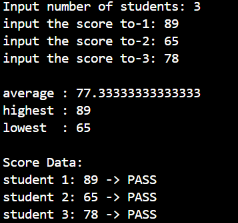

## 6.2 Assignment 2 — Campus Café Ordering Application

**Question**

Write a program that can manage food and beverage orders at a campus café. The program provides apredefined menu list, allows users to select menu items through a search feature, records orders, and calculates the total cost. 

Café menu list (initialize an array of String at declaration):

```String[] menu = {"Fried Rice", "Fried Noodles", "Toast", "French Fries", "PulledTea", "Cappuccino", "Chocolate Ice"};```

```int[] prices = {15000, 13000, 10000, 12000, 8000, 18000, 20000};```

The program you write must meet the following requirements:

- Menu search feature: the user enters the name of the food or beverage they want to order, and theprogram searches for that name in the menu array using the linear search algorithm. If it is found,display its price; if it is not found, inform the user that the menu item is not available.
- Ordering feature: the user enters the number of items to order, then for each item selects a menuname (which must be validated to ensure it exists in the menu list). Store the names of the ordereditems in a one-dimensional array that is separate from the main menu array.
- Calculate and display the total cost of all of the orders entered by the user.
- Display the list of orders that have been made, along with the total cost, in a neat and easy-to-readformat.

**The code answer**

```
import java.util.Scanner;

public class Assignment2 {

    static int searchMenu(String[] menu, String name) {
        for (int i = 0; i < menu.length; i++) {
            if (menu[i].equalsIgnoreCase(name)) {
                return i;
            }
        }
        return -1;
    }

    static void showMenu(String[] menu, int[] prices) {
        System.out.println("\n----- MENU LIST -----");
        for (int i = 0; i < menu.length; i++) {
            System.out.println((i + 1) + ". " + menu[i] + " - Rp" + prices[i]);
        }
        System.out.println("---------------------");
    }

    public static void main(String[] args) {
        Scanner sc = new Scanner(System.in);

        String[] menu = {"Fried Rice", "Fried Noodles", "Toast", "French Fries", "Pulled Tea", "Cappuccino", "Chocolate Ice"};
        int[] prices = {15000, 13000, 10000, 12000, 8000, 18000, 20000};

        String[] orders = new String[100];
        int orderCount = 0;
        int total = 0;

        int choice;
        do {
            System.out.println("\n=== CAMPUS CAFE ===");
            System.out.println("1. Search menu");
            System.out.println("2. Place order");
            System.out.println("3. Finish and show orders");
            System.out.print("Choose: ");
            choice = sc.nextInt();
            sc.nextLine();

            if (choice == 1) {
                showMenu(menu, prices);
                System.out.print("Enter menu name to search: ");
                String name = sc.nextLine();
                int index = searchMenu(menu, name);
                if (index != -1) {
                    System.out.println(menu[index] + " costs Rp" + prices[index]);
                } else {
                    System.out.println("Menu item is not available.");
                }

            } else if (choice == 2) {
                System.out.print("Number of items to order: ");
                int quantity = sc.nextInt();
                sc.nextLine();

                for (int i = 0; i < quantity; i++) {
                    int index;
                    do {
                        System.out.print("Menu name #" + (i + 1) + ": ");
                        String name = sc.nextLine();
                        index = searchMenu(menu, name);
                        if (index == -1) {
                            System.out.println("Menu item not found, please try again.");
                        }
                    } while (index == -1);

                    orders[orderCount] = menu[index];
                    orderCount++;
                    total += prices[index];
                }
            }
        } while (choice != 3);

        System.out.println("\n===== ORDER LIST =====");
        for (int i = 0; i < orderCount; i++) {
            System.out.println((i + 1) + ". " + orders[i]);
        }
        System.out.println("----------------------");
        System.out.println("Total cost: Rp" + total);
    }
}
```

**Result**

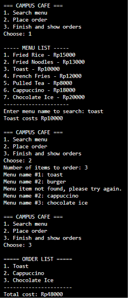
