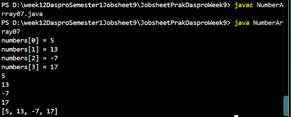
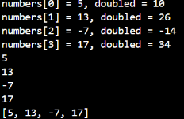
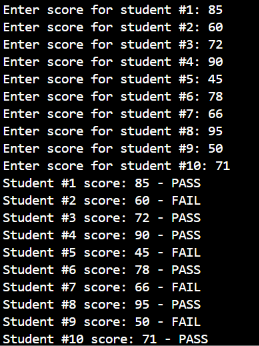
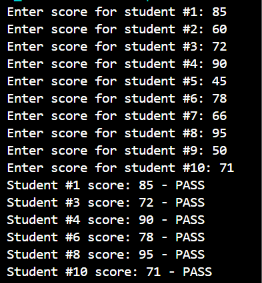
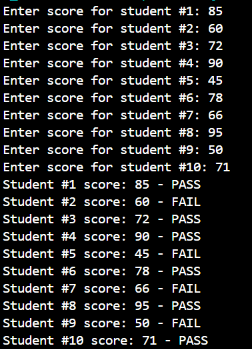
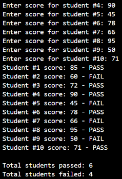

# REPORT JOBSHEET 9: ARRAY 1

Name: Davina Tegar Putri Ervia
NIM: 264107020083
GitHub: https://github.com/davinategar

# 1. Objective

* Students are able to understand the concept of one-dimensional arrays and how to declare, initialize,and access their elements in the Java programming language.
* Students are able to write programs that use one-dimensional arrays to store and process data,including the use of for and foreach loops.
* Students are able to apply arithmetic operations to array elements, such as calculating the total,average, highest value, and lowest value.
* Students are able to apply simple searching and sorting algorithms to one-dimensional arrays.
* Students are able to apply one-dimensional arrays to solve case studies that are relevant to campuslife and everyday situations.

# 2. Lab Exercises

## 2.1 Experiment 1: Declaring, Initializing, Filling, and Displaying Array Elements

**The code:**

```
import java.util.Arrays;

public class NumberArray07 {
    public static void main(String[] args) {
        int[] numbers = new int[4];

        numbers[0] = 5;
        numbers[1] = 13;
        numbers[2] = -7;
        numbers[3] = 17;

        for (int i = 0; i < numbers.length; i++) {
            System.out.println("numbers[" + i + "] = " + numbers[i]);
        }

        for (int number : numbers) {
            System.out.println(number);
        }

        System.out.println(Arrays.toString(numbers));
    }
}
```

**Result:**



**Questions:**

1. If the elements of the numbers array are changed to ```5.0, 12867, 7.5, 2000000```, what happens? Why does this happen?

    Answer: when i want to run the program it will be error, because in my code i input it ```int``` so when i writhe those numbers it will causes error. If we want to get output those numbers, we have to use ```double```.

2. Modify the program above by initializing the array elements at the same time the array is declared (without new ```int[4]``` and without filling the elements one by one)

   Code:

   ```
   import java.util.Arrays;

    public class NumberArray07 {
        public static void main(String[] args) {
            int[] numbers = {5, 13, -7, 17};

        for (int i = 0; i < numbers.length; i++) {
            System.out.println("numbers[" + i + "] = " + numbers[i]);
        }

        for (int number : numbers) {
            System.out.println(number);
        }

        System.out.println(Arrays.toString(numbers));
      }
   }
   ```

   Result:

   

   _note: still same like the previous code_

3. Change the display statement in step 4 to the following: ```System.out.println("numbers[" + i + "] = " +numbers[i] + ", doubled = " + (numbers[i] * 2));``` What is the output of the program? Explain themeaning of the statement.

   Answer: This line is used to display each array element along with the result            of multiplying it by 2.

   Result:
   
    

4. If the condition in the for loop above is changed to ```i <= 4```, what is the output of the program? Why?

   Answer: The program will produce an ArrayIndexOutOfBoundsException because                the array has only 4 elements, with indexes from 0 to 3. When i                  becomes 4, the program tries to access ```numbers[4]```, which does              not exist. Therefore, the program stops before executing the next                loops.

5. What is the difference between displaying an array using a for loop, a foreach loop, andArrays.toString() in step 5? When should each one be used?

   Answer: The for loop uses an index to access array elements, while the                   foreach loop accesses each element directly without using an index.              Arrays.toString() displays all array elements in one line. A for loop            is useful when we need the index, a foreach loop is useful when we               only need to read the elements, and Arrays.toString() is useful for d            isplaying the entire array quickly.

## Experiment 2: SIAKAD Case Study — Entering Student Scores and Pass/Fail Status  

**The code:**

```
import java.util.Arrays;
import java.util.Scanner;

public class ScoreArrayp07 {
    public static void main(String[] args) {
        int[] finalScores = new int[10];
        Scanner input = new Scanner(System.in);
        
        for (int i = 0; i < finalScores.length; i++) {
            System.out.print("Enter score for student #" + (i + 1) + ": ");
            finalScores[i] = input.nextInt();
        }

        for (int i = 0; i < finalScores.length; i++){
            String status = (finalScores[i] > 70) ? "PASS" : "FAIL";
            System.out.println("Student #" + (i + 1) + " score: " + finalScores[i] + " - " + status);
        }
    }
}
```

**The Result:** 



**Questions**

1. What does the condition ```i < finalScores.length``` in the loop above mean?

   Answer: The condition ```i < finalScores.length``` means that the loop will continue as long as the value of ```i``` is              smaller than the length of the array. The array finalScores contains 10 elements, so finalScores.length is 10.               The loop starts from ```i = 0``` and stops when i = 10.

2. Modify the program so that it displays only the scores of students who passed (score > 70), without displaying those who failed. Explain the flow of the program!

   Answer: The Code

   ```
   import java.util.Arrays;
   import java.util.Scanner;

    public class Exper {
    public static void main(String[] args) {
        int[] finalScores = new int[10];
        Scanner input = new Scanner(System.in);

        for (int i = 0; i < finalScores.length; i++) {
            System.out.print("Enter score for student #" + (i + 1) + ": ");
            finalScores[i] = input.nextInt();
        }

        for (int i = 0; i < finalScores.length; i++) {
            if (finalScores[i] > 70) {
                System.out.println("Student #" + (i + 1)
                        + " score: " + finalScores[i] + " - PASS");
            }
        }
    }
    }
   ```

   Result:

   

   Explanation:

   * First, the program creates an array to store 10 student scores.
   * The first for loop asks the user to enter scores for all 10 students.
   * The second for loop checks each student's score.
   * The if condition checks whether the score is greater than 70.
   * If the condition is true, the program displays the student's score and PASS status.
   * If the condition is false, the program skips that student and continues to the next one.

3. Change the loops in steps 4 and 5 from for loops to foreach loops. Can all parts of the program be converted to foreach? Explain which parts can and cannot be converted, along with the reasons.

   Answer: The Code:
   
   ```
   import java.util.Arrays;
   import java.util.Scanner;

    public class Experiment2Question4 {
    public static void main(String[] args) {
        int[] finalScores = new int[10];
        Scanner input = new Scanner(System.in);

        for (int i = 0; i < finalScores.length; i++) {
            System.out.print("Enter score for student #" + (i + 1) + ": ");
            finalScores[i] = input.nextInt();
        }

        int studentNumber = 1;

        for (int score : finalScores) {
            String status = (score > 70) ? "PASS" : "FAIL";

            System.out.println("Student #" + studentNumber
                    + " score: " + score + " - " + status);

            studentNumber++;
        }
    }
    }
   ```

   Result:
   

   Explanation:

   No, not all parts of the program can be converted to foreach loops.

   * The first loop cannot be directly converted into foreach because it is used to store input values into specific array        positions. A foreach loop does not provide direct access to array indexes for assigning values.
   * The second loop can be converted into foreach because it only reads and displays the scores stored in the array. It          does not need to change the array values.

   The variable studentNumber is used to display the student number because foreach does not automatically provide the array    index.

4. Modify the program so that it also calculates and displays the number of students who passed and the number of students who failed at the end of the program.

   Answer: The Code:

   ```   
    import java.util.Scanner;

    public class Experiment2Question4 {
    public static void main(String[] args) {
        int[] finalScores = new int[10];
        Scanner input = new Scanner(System.in);

        int passCount = 0;
        int failCount = 0;

        for (int i = 0; i < finalScores.length; i++) {
            System.out.print("Enter score for student #" + (i + 1) + ": ");
            finalScores[i] = input.nextInt();
        }

        for (int i = 0; i < finalScores.length; i++) {
            if (finalScores[i] > 70) {
                System.out.println("Student #" + (i + 1)
                        + " score: " + finalScores[i] + " - PASS");
                passCount++;
            } else {
                System.out.println("Student #" + (i + 1)
                        + " score: " + finalScores[i] + " - FAIL");
                failCount++;
            }
        }

        System.out.println("\nTotal students passed: " + passCount);
        System.out.println("Total students failed: " + failCount);
    }
    }
   ```

   Result:

   
